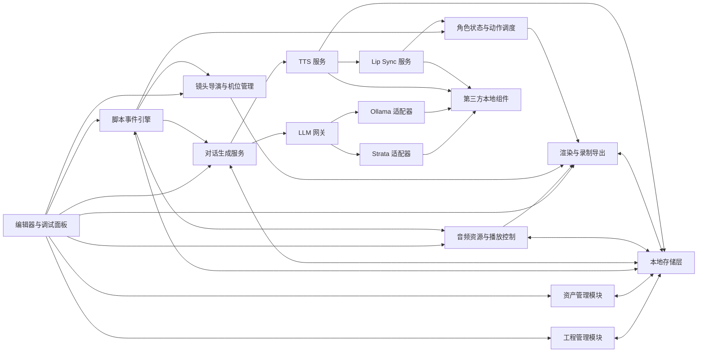
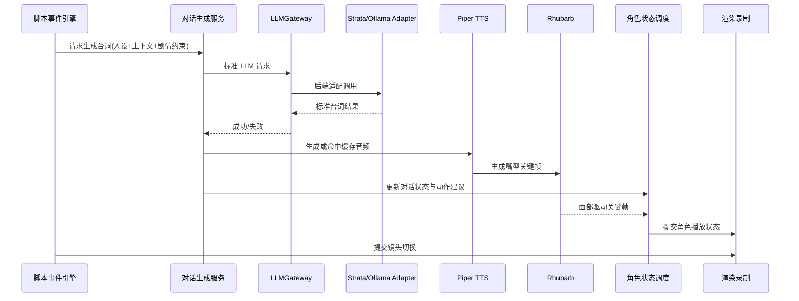

# HLD 概要设计

## 1. 目标与边界

本系统面向“全本地离线、零付费、全开源组件”的 AI 短片生产管线，严格对齐 PRD V1.8，设计目标如下：

- 固定 3D 资产与统一三维空间，保证角色、场景、道具在全流程中的视觉稳定性。
- AI 仅负责受约束的台词生成、行为决策与本地语音生成，不参与画面生成。
- 支持两种拍摄模式：脚本自动分镜渲染、上帝导播手动多机位录制。
- 支持 LLM 后端解耦、离线运行、故障降级与工程复用。
- 单模块故障不破坏整体剧情推进，优先“成片连续性”而不是单点最佳效果。

不在本次 HLD 范围内的内容：

- GDScript 类设计、场景树节点组织、线程模型的底层实现细节。
- 高级全局光照烘焙、复杂布料、流体、海量人群模拟。
- 闭源或付费云 API 接入。

## 2. 架构原则

1. 本地优先：所有关键能力在断网环境下可运行。
2. 松耦合：渲染、事件、LLM、TTS、唇形、音频、存储分别隔离。
3. 可降级：LLM、TTS、Lip Sync、音频资源任一模块异常时，剧情主流程继续。
4. 可替换：Strata 与 Ollama 通过统一适配器接口接入。
5. 可复用：资产、人设、脚本、镜头、缓存、日志均可序列化保存。
6. 先约束后生成：脚本框架、触发器、状态机先确定，AI 只在受控边界内生成。

## 3. 总体架构



## 4. 模块划分

### 4.1 编辑器与调试面板

职责：

- 提供工程、资产、脚本、人设、机位、LLM 配置、音频配置的编辑入口。
- 提供事件记录、AI 台词预览、角色状态查看、音频预览、错误日志过滤。
- 发起导入、保存、试运行、自动拍摄、导播录制、导出等操作。

边界：

- 仅负责配置与可视化控制，不直接承载业务状态机。

### 4.2 工程管理模块

职责：

- 统一保存和加载工程文件。
- 管理工程内资源索引、引用关系、版本号与兼容性检查。
- 保存场景布局、脚本、人设、机位、LLM 后端配置、音频配置、缓存索引。

边界：

- 不负责资源运行时播放，仅负责配置持久化与恢复。

### 4.3 资产管理模块

职责：

- 导入 GLB/GLTF 角色、场景、道具资产。
- 管理动作片段元数据与动画优先级。
- 锁定对象坐标，防止场景编辑与拍摄阶段出现位移错乱。

边界：

- 不决定动作何时播放，动作触发由事件引擎和状态机控制。

### 4.4 脚本事件引擎

职责：

- 解析文本脚本中的场景、角色、触发器、剧情分支、镜头序列。
- 驱动时间触发、距离触发、对话结束触发、角色状态触发。
- 维护场景级事件执行队列，保证事件按约束推进。

关键特性：

- 脚本优先于 AI，自定义脚本是运行时真源。
- 支持“一键关闭大模型”的保底模式，直接走预设台词与动画。
- 事件与镜头序列可导入导出。

### 4.5 角色状态与动作调度

职责：

- 管理空闲、移动、交谈、情绪、战斗等角色状态切换。
- 根据事件结果调度动作库中的动画片段。
- 处理动作优先级与打断关系，高优先级动作覆盖低优先级动作。

边界：

- 不负责台词文本生成。
- 不负责音频文件生成。

### 4.6 对话生成服务

职责：

- 将人设、上下文、剧情约束组装为统一推理请求。
- 与 LLM 网关交互，获取候选台词。
- 在后端异常时降级到预设台词。
- 将对话日志本地落盘。

边界：

- 不感知 Strata 或 Ollama 的底层协议差异。
- 不直接管理网络重试、熔断与后端健康检查，这部分由 LLM 网关承担。

### 4.7 LLM 网关与双后端适配器

职责：

- 提供统一的 LLM 调用入口。
- 适配 Strata 与 Ollama 两类后端，屏蔽协议、参数和响应差异。
- 管理请求队列、并发上限、超时、重试、熔断、健康探测。

设计拆分：

- `LLMGateway`
  - 统一路由入口
  - 请求排队、限流、优先级控制
  - 熔断状态机
  - 降级决策
- `StrataAdapter`
  - 将标准请求映射为 Strata 请求格式
  - 解析 Strata 返回结果与错误
- `OllamaAdapter`
  - 将标准请求映射为 Ollama 请求格式
  - 解析 Ollama 返回结果与错误

适配策略：

- 网关对上只暴露标准请求结构，不透出后端特定字段。
- 运行时通过工程配置选择主后端。
- 允许手动切换后端，但同一会话内一次台词生成只绑定一个后端实例。
- 后端健康异常时，可按“重试主后端 -> 切预设台词”顺序处理；不在本期要求中自动切到另一后端继续推理，以避免语义和时序不可控。

### 4.8 TTS 与唇形同步

职责：

- 基于 Piper TTS 本地生成 wav 语音。
- 对相同台词做缓存复用。
- 调用 Rhubarb Lip Sync 为对应音频生成嘴型关键帧。
- 将关键帧结果传递给角色面部驱动层。

降级策略：

- TTS 失败：优先复用已有缓存；无缓存则生成静音占位音频，保证时间线继续。
- Lip Sync 失败：语音照常播放，仅关闭对应段落的口型驱动。

### 4.9 音频资源与播放控制

职责：

- 管理环境音、音效、背景音乐资源库。
- 将音频绑定到场景、触发器、角色事件。
- 控制音量、淡入淡出与多音频通道并发播放。

边界：

- 不负责语音合成；对白语音由 TTS 模块提供。

### 4.10 镜头导演与渲染录制

职责：

- 管理预定义机位：全景、中景、特写、俯拍等。
- 执行模式 A 自动脚本拍摄：按脚本时间线切镜。
- 执行模式 B 导播拍摄：人工实时切换机位并录屏。
- 输出视频或序列帧，支持分辨率、帧率、编码和 PNG/EXR 参数配置。

边界：

- 不生成剧情，仅消费脚本、状态与音频结果。

### 4.11 本地存储层

职责：

- 保存工程文件、脚本、人设、镜头配置、音频缓存索引、日志文件。
- 保存导出产物索引，便于追溯。
- 通过统一路径规范隔离配置、缓存、日志、导出目录。

## 5. 高层数据流

### 5.1 编辑与保存流

1. 用户在编辑器配置资产、人设、脚本、机位、后端与音频设置。
2. 工程管理模块执行引用检查与版本校验。
3. 数据写入本地存储层。
4. 调试面板从存储层读取并回显最新配置。

### 5.2 运行时对白流



### 5.3 保底与降级流

1. 若工程开启保底模式，脚本事件引擎直接读取预设台词与动画，不访问 LLM。
2. 若 LLM 超时、熔断或不可用，对话生成服务回退到预设台词。
3. 若 TTS 失败，复用缓存音频；若无缓存则写入静音占位音频。
4. 若 Lip Sync 失败，仅取消口型动画，角色动作与镜头继续。
5. 若单条环境音或音效加载失败，仅跳过对应音频事件，不中断剧情主线。

## 6. 第三方组件集成

| 组件 | 角色 | 集成方式 | 失败影响 | 降级策略 |
| --- | --- | --- | --- | --- |
| Godot 4 | 渲染、编辑、播放主容器 | 本地引擎集成 | 核心不可用 | 无，属基础运行环境 |
| Strata | LLM 后端之一 | 本地 HTTP/进程服务 | 台词生成失败 | 回退预设台词 |
| Ollama | LLM 后端之一 | 本地 HTTP 服务 | 台词生成失败 | 回退预设台词 |
| Piper TTS | 本地语音合成 | 本地 CLI/服务调用 | 语音缺失 | 使用缓存或静音占位 |
| Rhubarb Lip Sync | 嘴型关键帧生成 | 本地 CLI 调用 | 口型缺失 | 关闭口型驱动 |
| Kdenlive / Resolve Free | 后期剪辑 | 导出后离线使用 | 不影响引擎导出 | 不在运行时链路内 |

## 7. 存储设计

建议目录结构如下：

```text
project-root/
  project.json
  assets/
  personas/
  scripts/
  cameras/
  audio/
    bgm/
    sfx/
    ambience/
    dialogue-cache/
  cache/
    tts/
    lipsync/
  logs/
    debug/
    business/
    error/
  exports/
```

设计要点：

- 配置数据与运行缓存分离。
- 缓存允许删除和重建，不作为唯一真源。
- 日志按级别独立存储，便于导出与问题定位。

## 8. 降级与容错策略

| 故障点 | 检测方式 | 影响范围 | 默认处理 |
| --- | --- | --- | --- |
| Strata/Ollama 不可达 | 健康检查失败、超时、连接错误 | 仅对白生成 | 使用预设台词 |
| LLM 输出非法 | 校验失败、空文本 | 仅当前对白 | 使用预设台词并记日志 |
| TTS 失败 | 进程退出非 0、输出文件缺失 | 当前语音段 | 命中缓存或静音占位 |
| Lip Sync 失败 | 进程退出非 0、关键帧空 | 当前口型段 | 跳过口型驱动 |
| 音效缺失 | 文件不存在、解码失败 | 单个音轨事件 | 跳过该音频事件 |
| 导出编码失败 | 编码器返回错误 | 当前导出任务 | 保留中间产物与日志，允许重试 |

容错原则：

- 失败隔离到“单事件”或“单镜头”粒度，不向整集扩散。
- 任何外部组件错误都必须转为标准错误码与日志记录。
- 时间线推进优先级高于局部效果完整性。

## 9. 高层接口

以下接口为 HLD 级抽象，不展开语言级签名。

### 9.1 工程与配置

- `ProjectRepository`
  - `loadProject`
  - `saveProject`
  - `exportProjectPackage`
  - `validateProjectReferences`

### 9.2 脚本与事件

- `ScriptRuntime`
  - `loadScript`
  - `startScene`
  - `evaluateTriggers`
  - `advanceEvent`
  - `serializeTimeline`

### 9.3 角色与动作

- `CharacterStateService`
  - `transitionState`
  - `submitAction`
  - `interruptAction`
  - `queryCharacterState`

### 9.4 LLM 网关

- `LLMGateway`
  - `generateDialogue`
  - `checkBackendHealth`
  - `switchBackend`
  - `getCircuitState`

- `ILLMBackendAdapter`
  - `buildRequest`
  - `invoke`
  - `parseResponse`
  - `mapError`

### 9.5 音频与唇形

- `DialogueAudioService`
  - `synthesizeOrLoadCache`
  - `generateLipSync`
  - `bindAudioToCharacter`

- `AudioPlaybackService`
  - `playBgm`
  - `playAmbience`
  - `playSfx`
  - `fadeChannel`

### 9.6 镜头与导出

- `CameraDirector`
  - `activateCamera`
  - `applyShotSequence`
  - `beginLiveDirecting`

- `RenderExportService`
  - `renderSequence`
  - `recordLiveSession`
  - `exportFrames`
  - `exportVideo`

## 10. 评审关注点

本 HLD 评审建议重点确认以下问题：

1. 是否接受“主后端失败后默认回退预设台词，而非自动切另一 LLM 后端”的策略。
2. 是否接受“TTS 失败时使用静音占位音频保障时间线”的容错方案。
3. 自动拍摄与导播拍摄是否共用一套镜头资源定义与导出参数模型。
4. 工程、缓存、导出目录是否按本文建议的统一目录约定落地。
5. LLM、TTS、Lip Sync 的调用方式是统一封装成本地服务，还是允许服务与 CLI 混合存在。
