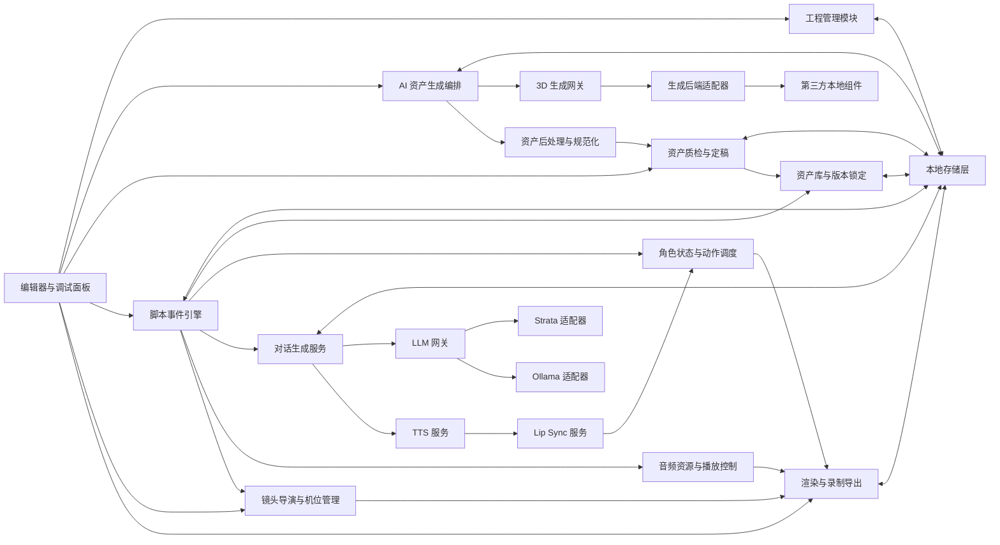
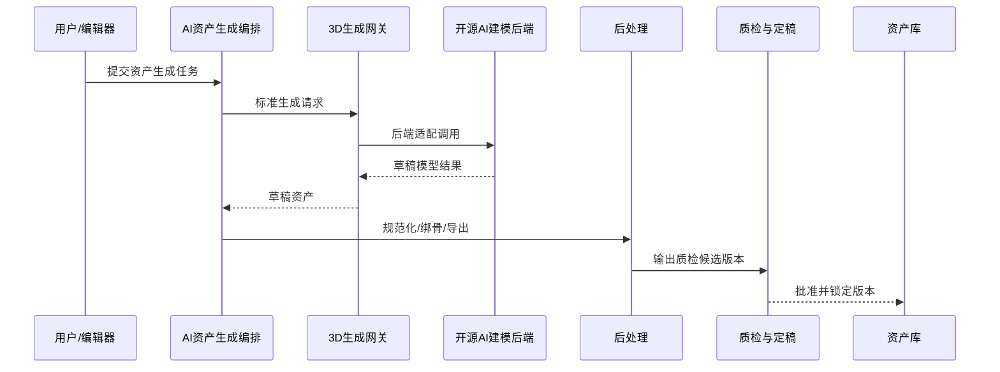
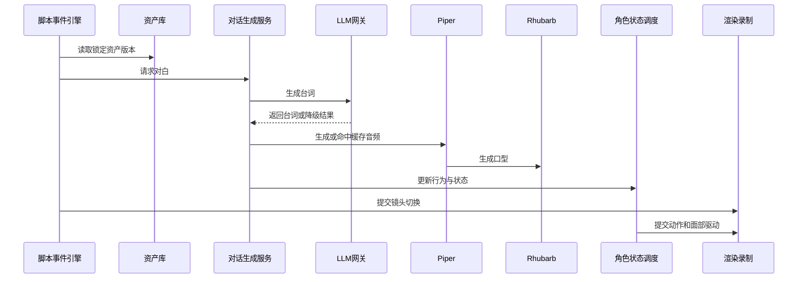

# HLD 概要设计

## 1. 目标与边界

本系统已从“固定 3D 资产驱动的 AI 短片管线”调整为“AI 参与 3D 资产生成与迭代的本地短片生产管线”。新的目标如下：

- AI 负责角色、场景、道具等 3D 资产的生成与持续迭代。
- 生成后的资产必须经过后处理、质检、定稿与版本锁定，才能进入拍摄资产库。
- Godot 4 负责场景搭建、角色驱动、镜头控制、渲染录制与导出。
- LLM 继续负责受约束的台词生成与行为决策，TTS 与 Lip Sync 继续负责本地语音和口型。
- 资产生成期与拍摄运行期解耦，单模块故障不应中断已批准资产的剧情生产。

本次 HLD 不展开以下内容：

- GDScript 类结构、线程池实现、任务调度底层细节。
- 具体某个开源 3D 生成模型的算法原理与训练细节。
- 闭源云 API、付费素材市场与商业 SaaS 方案。

## 2. 架构原则

1. 本地优先：资产生成、资产处理、对白、语音与渲染链路均可在离线环境中运行。
2. 双阶段隔离：预生产的资产生成链路与拍摄链路分开设计，避免互相阻塞。
3. 定稿先行：只有通过质检并锁定版本的资产才能进入正式拍摄。
4. 故障收敛：生成失败影响草稿资产，不影响已批准版本的剧情生产。
5. 后端可替换：LLM 后端与 AI 3D 生成后端都通过统一网关和适配器抽象。
6. 低耦合：资产、脚本、对白、语音、镜头、导出、日志各自独立。

## 3. 总体架构



## 4. 分层说明

### 4.1 预生产层

职责：

- 根据角色描述、风格提示、草图或参考图发起 3D 资产生成。
- 生成角色、场景、道具草稿版本。
- 执行资产清洗、尺度统一、材质整理、骨骼绑定与导出。
- 做质量门禁，决定是否批准进入拍摄资产库。

关键特点：

- 面向“资产生产”而不是剧情运行。
- 以异步作业为主，不与实时拍摄共用执行节奏。

### 4.2 拍摄运行层

职责：

- 从资产库中读取已锁定版本资产。
- 解析脚本与触发器，驱动角色状态、台词、音频、镜头和导出。
- 在 LLM、TTS、Lip Sync 等模块异常时执行运行期降级。

关键特点：

- 严禁直接消费未批准的草稿资产。
- 对时间线连续性要求高于局部效果完整性。

## 5. 核心模块

### 5.1 编辑器与调试面板

职责：

- 提供工程、资产生成、资产审核、脚本、人设、机位、后端与音频设置入口。
- 展示资产生成任务、草稿预览、质检报告、版本锁定状态。
- 展示对白预览、事件记录、角色状态、日志与导出记录。

边界：

- 仅做配置与可视化，不承担核心执行逻辑。

### 5.2 工程管理模块

职责：

- 保存和加载工程主配置。
- 管理资产引用、脚本、人设、机位、版本锁定关系与兼容性检查。
- 区分草稿资产、已批准资产和运行期缓存。

边界：

- 不执行资产生成，也不驱动运行时事件。

### 5.3 AI 资产生成编排

职责：

- 接收生成任务，组装提示词、参考图、目标资产类型与质量要求。
- 创建和跟踪长任务。
- 管理队列、并发、超时、取消与失败回收。

边界：

- 只负责作业调度和状态追踪，不直接定义具体模型协议。

### 5.4 3D 生成网关与后端适配器

职责：

- 对接开源 AI 建模后端，统一暴露生成、细化、重试、状态查询等接口。
- 隔离不同后端在请求格式、任务状态、文件输出上的差异。

设计拆分：

- `AssetGenerationGateway`
  - 统一提交生成作业
  - 查询作业状态
  - 控制并发与超时
  - 统一错误映射
- `IAssetGeneratorAdapter`
  - 构造后端请求
  - 解析后端结果
  - 将结果转换为标准草稿资产结构

### 5.5 资产后处理与规范化

职责：

- 规范化网格、材质、贴图和坐标系。
- 统一尺度、命名和导出格式。
- 对角色资产执行绑骨、重定向或目标骨架兼容处理。
- 产出 Godot 可直接导入的 `GLB/GLTF` 与预览图。

边界：

- 不负责审美评估，只做技术层面的可导入与可驱动处理。

### 5.6 资产质检与定稿

职责：

- 验证模型、贴图、尺度、骨骼、材质、导入结果是否达标。
- 生成质量报告。
- 审核并批准资产版本进入正式资产库。
- 锁定运行期可使用的 `approved revision`。

关键策略：

- 草稿资产永不直接进入拍摄链路。
- 批准后的资产才具备运行期引用资格。

### 5.7 资产库与版本锁定

职责：

- 保存角色、场景、道具的历史版本。
- 标记当前拍摄使用的锁定版本。
- 支持回滚到最近已批准版本。

边界：

- 不承担生成和后处理，只负责版本真源管理。

### 5.8 脚本事件引擎

职责：

- 解析文本脚本中的场景、出场角色、触发器、剧情分支、镜头序列。
- 在运行期绑定资产库中已批准的资产版本。
- 驱动时间触发、距离触发、对话结束触发和角色状态触发。

关键特性：

- 脚本仍是运行时真源。
- 脚本只消费锁定资产版本，不直接操纵生成草稿。

### 5.9 角色状态与动作调度

职责：

- 管理空闲、移动、交谈、情绪、战斗等状态切换。
- 调度动作片段与打断优先级。
- 将 Lip Sync 驱动与角色面部控制对接。

### 5.10 对话生成服务与 LLM 网关

职责：

- 基于人设、剧情约束和上下文生成台词。
- 与 Strata 或 Ollama 解耦接入。
- 管理请求队列、超时、重试、熔断与降级。

策略：

- 主后端失败时降级到预设台词，而不是自动切换语义来源不同的备用 LLM 输出。

### 5.11 TTS 与唇形同步

职责：

- 使用 Piper 生成对白 wav。
- 复用相同台词的音频缓存。
- 使用 Rhubarb 生成口型关键帧。

降级：

- TTS 失败时优先使用缓存；无缓存则生成静音占位。
- Lip Sync 失败时仅关闭口型，不阻塞镜头和动作。

### 5.12 镜头导演与渲染录制

职责：

- 管理自动脚本拍摄和上帝导播拍摄。
- 控制多机位切换与录制。
- 输出视频或 PNG/EXR 序列帧。

### 5.13 本地存储层

职责：

- 保存工程、草稿资产、已批准资产、质量报告、缓存、日志与导出结果。
- 对草稿目录、正式资产目录、缓存目录做物理隔离。

## 6. 核心数据流

### 6.1 资产生成与定稿流



### 6.2 运行期拍摄流



## 7. 第三方组件集成

| 组件 | 角色 | 集成方式 | 失败影响 | 默认处理 |
| --- | --- | --- | --- | --- |
| Godot 4 | 编辑、渲染、录制主容器 | 本地引擎 | 核心不可用 | 无 |
| 开源 AI 建模后端 | 角色/场景/道具生成 | 本地服务/CLI | 草稿生成失败 | 保留旧版本，任务失败 |
| Strata | LLM 后端之一 | 本地服务 | 台词生成失败 | 预设台词降级 |
| Ollama | LLM 后端之一 | 本地服务 | 台词生成失败 | 预设台词降级 |
| Piper TTS | 本地语音合成 | CLI/服务 | 语音缺失 | 缓存或静音占位 |
| Rhubarb Lip Sync | 嘴型生成 | CLI | 口型缺失 | 关闭口型驱动 |

## 8. 存储设计

建议目录结构：

```text
project-root/
  project.json
  personas/
  scripts/
  cameras/
  assets/
    drafts/
      characters/
      scenes/
      props/
    approved/
      characters/
      scenes/
      props/
    actions/
  reports/
    quality/
  audio/
    bgm/
    sfx/
    ambience/
    dialogue-cache/
  cache/
    tts/
    lipsync/
    generation/
  logs/
    debug/
    business/
    error/
  exports/
```

原则：

- 草稿资产与批准资产必须分目录隔离。
- 运行期只读取 `approved` 目录。
- 缓存和中间件产物允许删除重建，不作为真源。

## 9. 降级与容错

| 故障点 | 影响范围 | 默认处理 |
| --- | --- | --- |
| AI 建模后端不可达 | 当前草稿资产任务 | 任务失败并保留旧版本 |
| 草稿资产后处理失败 | 当前草稿资产任务 | 停留草稿态，禁止发布 |
| 质量门禁不通过 | 当前候选版本 | 不进入资产库 |
| LLM 超时/熔断 | 当前对白 | 回退预设台词 |
| TTS 失败 | 当前语音段 | 使用缓存或静音占位 |
| Lip Sync 失败 | 当前口型段 | 跳过口型驱动 |
| 导出失败 | 当前导出任务 | 保留中间产物与日志，允许重试 |

容错原则：

- 资产生产故障不影响已批准资产的拍摄。
- 拍摄运行故障按单对白、单镜头、单事件收敛。
- 任一外部工具故障都必须映射为标准错误码和可追踪日志。

## 10. 高层接口

### 10.1 工程与配置

- `ProjectRepository`
  - `loadProject`
  - `saveProject`
  - `validateProjectReferences`
  - `lockRuntimeAssetRevision`

### 10.2 资产生成与资产库

- `AssetGenerationOrchestrator`
  - `submitGenerationJob`
  - `queryGenerationJob`
  - `cancelGenerationJob`
  - `retryGenerationJob`

- `AssetGenerationGateway`
  - `generateAsset`
  - `refineAsset`
  - `getBackendHealth`

- `AssetPostProcessService`
  - `normalizeMesh`
  - `normalizeMaterial`
  - `rigOrRetarget`
  - `exportRuntimeAsset`

- `AssetReviewService`
  - `runQualityChecks`
  - `approveRevision`
  - `rejectRevision`

- `AssetLibraryService`
  - `publishApprovedRevision`
  - `rollbackRevision`
  - `resolveRuntimeRevision`

### 10.3 运行时拍摄

- `ScriptRuntime`
  - `loadScript`
  - `startScene`
  - `evaluateTriggers`
  - `advanceEvent`

- `CharacterStateService`
  - `transitionState`
  - `submitAction`
  - `interruptAction`

- `LLMGateway`
  - `generateDialogue`
  - `checkBackendHealth`
  - `getCircuitState`

- `DialogueAudioService`
  - `synthesizeOrLoadCache`
  - `generateLipSync`

- `CameraDirector`
  - `activateCamera`
  - `applyShotSequence`
  - `beginLiveDirecting`

- `RenderExportService`
  - `renderSequence`
  - `recordLiveSession`
  - `exportFrames`
  - `exportVideo`

## 11. 评审关注点

本轮概要设计评审建议重点确认：

1. 是否接受“AI 可以持续生成新资产，但正式拍摄只允许使用已批准并锁定的资产版本”。
2. 是否接受资产生成失败时“保留旧版本继续生产”，而不是阻塞整条拍摄链路。
3. 角色资产是否要求统一目标骨架，以保障动作库复用。
4. 草稿资产、批准资产、缓存、中间产物是否按本文目录边界隔离。
5. AI 建模后端是统一封装为本地服务，还是允许服务与 CLI 混合接入。
