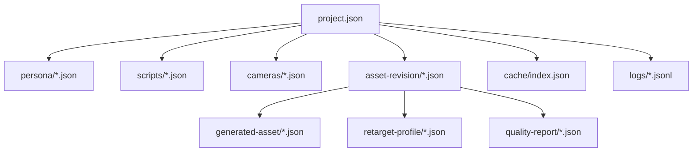

# 数据结构与 JSON Schema

## 1. 目的

本文定义在“AI 参与 3D 资产生成”方向下的工程主数据结构，覆盖工程配置、角色人设、事件脚本、机位、草稿资产、资产版本、重定向配置、质量报告、缓存与日志。它们共同作为：

- 工程读写时的结构校验依据
- 编辑器表单与后端接口的统一契约
- 资产生成、资产定稿与拍摄运行的边界定义
- 集成测试输入样本的结构规范

Schema 版本采用 `JSON Schema Draft 2020-12`。

## 2. Schema 清单

| 文件 | 说明 |
| --- | --- |
| `schemas/project.schema.json` | 工程主文件，聚合项目配置与资产管线设置 |
| `schemas/persona.schema.json` | 角色人设、对白约束与外观生成提示 |
| `schemas/script.schema.json` | 场景、事件、触发器、镜头序列与锁定资产引用 |
| `schemas/camera.schema.json` | 预定义机位与导播配置 |
| `schemas/cache.schema.json` | TTS、Lip Sync 与生成中间产物缓存索引 |
| `schemas/log.schema.json` | 调试、业务、错误日志单条结构 |
| `schemas/generated-asset.schema.json` | 草稿资产主结构 |
| `schemas/asset-revision.schema.json` | 资产版本、发布状态与运行时锁定状态 |
| `schemas/retarget-profile.schema.json` | 角色目标骨架与动作重定向配置 |
| `schemas/quality-report.schema.json` | 资产质量门禁与导入检查报告 |

## 3. 设计原则

1. 工程主文件是聚合入口，但不内嵌大体积模型数据。
2. 草稿资产和已批准资产必须分结构、分目录、分生命周期管理。
3. 拍摄运行期只允许引用已批准且锁定的资产版本。
4. 缓存和中间产物可删除重建，不是唯一真源。
5. 日志和质量报告必须可追踪到 `asset_id`、`revision_id`、`job_id` 或 `scene_id`。
6. 所有 ID 使用字符串，避免跨工具和引擎冲突。

## 4. 核心结构说明

### 4.1 工程文件 `project.schema.json`

覆盖内容：

- 项目元信息
- 资产生成管线配置
- 资产库与运行期锁定版本索引
- 人设、脚本、机位文件引用
- LLM 后端配置
- 音频配置
- 导出默认参数

约束重点：

- 工程文件必须显式区分 `asset_pipeline` 与 `runtime_asset_locks`
- `backend.active_backend` 仅允许 `strata` 或 `ollama`
- `render.output_format` 仅允许 `video`、`png_sequence`、`exr_sequence`

### 4.2 人设文件 `persona.schema.json`

覆盖内容：

- 角色标识、简介、说话风格、约束条件
- 预设台词
- 角色外观生成提示，包括正向提示、反向提示和风格标签

约束重点：

- `fallback_lines` 必填，用于 LLM 降级
- `visual_profile` 用于 AI 建模期，不参与运行时对白逻辑

### 4.3 脚本文件 `script.schema.json`

覆盖内容：

- 场景元信息
- 出场角色
- 事件列表
- 触发器与分支
- 镜头序列
- 运行期所需锁定资产引用

约束重点：

- 事件 ID 在单脚本内唯一
- 触发器类型仅允许 `time`、`distance`、`dialogue_finished`、`state`
- 脚本引用资产时，只能引用 `approved revision`

### 4.4 草稿资产 `generated-asset.schema.json`

覆盖内容：

- 草稿资产 ID
- 资产类型
- 生成来源
- 生成输入
- 当前草稿状态
- 预览图、输出文件与作业关联

约束重点：

- 草稿资产状态允许 `queued`、`processing`、`draft_ready`、`postprocess_failed`、`rejected`
- 草稿资产不得直接作为运行时引用

### 4.5 资产版本 `asset-revision.schema.json`

覆盖内容：

- 资产版本 ID
- 所属资产 ID
- 版本状态
- 技术产物路径
- 骨架和导出信息
- 发布与锁定状态

约束重点：

- 只有 `approved` 状态版本允许被 `runtime_locked=true`
- 版本一旦锁定给正式拍摄，不得被静默覆盖

### 4.6 重定向配置 `retarget-profile.schema.json`

覆盖内容：

- 目标骨架标识
- 角色骨骼映射
- 根骨与四肢关键点定义
- 动作库兼容配置

用途：

- 保障 AI 生成角色能进入统一动作库体系
- 为动作复用和角色替换提供结构约束

### 4.7 质量报告 `quality-report.schema.json`

覆盖内容：

- 报告 ID
- 资产与版本标识
- 网格、材质、尺度、骨架、Godot 导入等检查结果
- 最终结论与阻断项

### 4.8 缓存索引 `cache.schema.json`

覆盖内容：

- TTS 缓存
- Lip Sync 缓存
- 生成预览与中间导出缓存

### 4.9 日志结构 `log.schema.json`

覆盖内容：

- 级别、模块、动作、错误码
- 链路追踪字段
- 降级标记
- 资产或场景上下文

## 5. 文件关系

## 6. 校验建议

- 工程保存前校验 `project.schema.json`
- 人设保存前校验 `persona.schema.json`
- 资产生成作业落盘前校验 `generated-asset.schema.json`
- 资产批准发布前同时校验 `asset-revision.schema.json` 和 `quality-report.schema.json`
- 脚本导入前校验 `script.schema.json`
- 日志写入时仅做轻量字段校验，避免影响运行时性能

## 7. 使用约定

- 工程主文件建议命名为 `project.json`
- 草稿资产、资产版本、质量报告分别独立成文件
- 日志建议使用 `jsonl`
- 缓存索引按项目独立维护，禁止跨工程共享运行时锁定资产信息
