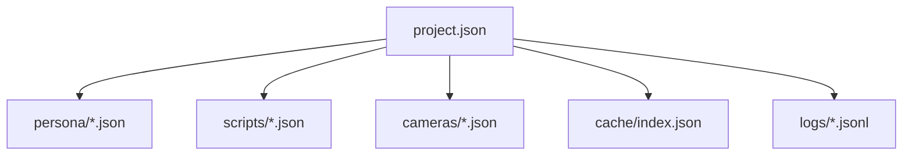

# 数据结构与 JSON Schema

## 1. 目的

本文定义工程配置、角色人设、事件脚本、机位配置、缓存索引、日志记录的结构边界，并提供对应 JSON Schema 文件，作为：

- 工程读写时的结构校验依据
- 编辑器表单与配置面板的数据契约
- 集成测试中的输入样本规范

Schema 版本采用 `JSON Schema Draft 2020-12`。

## 2. Schema 清单

| 文件 | 说明 |
| --- | --- |
| `schemas/project.schema.json` | 工程主文件，聚合项目级配置 |
| `schemas/persona.schema.json` | 角色人设与行为约束 |
| `schemas/script.schema.json` | 场景、事件、触发器、分支、镜头序列 |
| `schemas/camera.schema.json` | 预定义机位与导播配置 |
| `schemas/cache.schema.json` | TTS 与 Lip Sync 缓存索引 |
| `schemas/log.schema.json` | 调试、业务、错误日志的单条结构 |

## 3. 设计原则

1. 工程文件是聚合入口，持有对脚本、人设、机位和音频配置的引用。
2. 脚本是运行时真源，事件推进以脚本定义为准。
3. 缓存是可重建产物，不承载唯一真值。
4. 日志结构统一，便于筛选、导出与链路追踪。
5. 所有 ID 使用字符串，避免引擎层与外部工具之间的整数冲突。

## 4. 核心结构说明

### 4.1 工程文件 `project.schema.json`

覆盖内容：

- 项目元信息
- 资产清单与引用
- 人设文件引用
- 脚本文件引用
- 机位文件引用
- LLM 后端配置
- 音频资源库配置
- 导出默认参数

约束重点：

- `backend.active_backend` 仅允许 `strata` 或 `ollama`
- `render.output_format` 仅允许 `video`、`png_sequence`、`exr_sequence`
- 工程文件仅保存引用与配置，不内嵌大体积缓存数据

### 4.2 人设文件 `persona.schema.json`

覆盖内容：

- 角色标识与展示名称
- 角色简介与世界观定位
- 说话风格
- 禁止项与剧情约束
- 默认预设台词库

约束重点：

- 人设约束只用于台词与行为风格，不定义底层骨骼或材质数据
- `fallback_lines` 必填，用于 LLM 故障时降级

### 4.3 脚本文件 `script.schema.json`

覆盖内容：

- 场景元信息
- 出场角色
- 事件列表
- 触发器
- 分支跳转
- 镜头序列
- 保底模式所需预设台词与动作引用

约束重点：

- 事件 ID 在单脚本内唯一
- 触发器类型仅允许 `time`、`distance`、`dialogue_finished`、`state`
- 动作优先级由事件动作声明，值越大优先级越高

### 4.4 机位文件 `camera.schema.json`

覆盖内容：

- 预定义机位
- 机位类型
- 位置、旋转、FOV
- 导播模式可切机位列表
- 自动分镜引用的镜头 ID

### 4.5 缓存索引 `cache.schema.json`

覆盖内容：

- 缓存键
- 台词文本摘要
- 语音文件路径
- 唇形文件路径
- 命中次数
- 最后访问时间

### 4.6 日志记录 `log.schema.json`

覆盖内容：

- 日志级别
- 模块
- 动作
- 错误码
- 链路追踪字段
- 降级标记
- 附加上下文

## 5. 文件间关系

## 6. 校验建议

- 工程保存前：校验 `project.schema.json`
- 人设编辑保存前：校验 `persona.schema.json`
- 脚本导入前：校验 `script.schema.json`
- 导出任务开始前：校验项目是否存在失效引用
- 日志写入时：仅做轻量字段校验，避免影响运行时性能

## 7. 使用约定

- 工程文件建议命名为 `project.json`
- 日志文件建议采用 `jsonl`，每行一条 `log.schema.json` 结构
- 缓存索引建议按项目维度独立维护，避免跨工程污染
